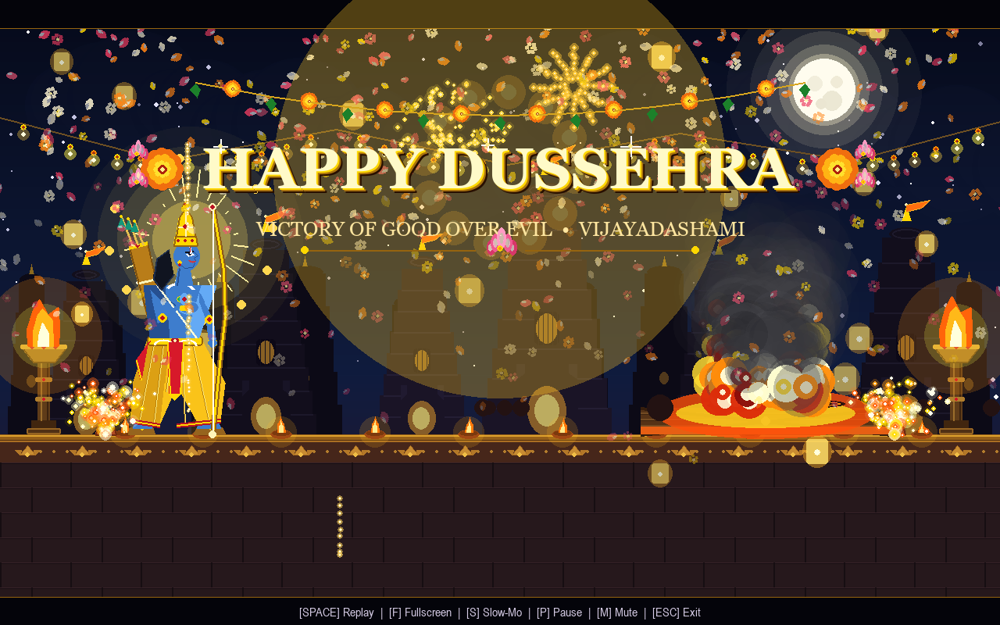
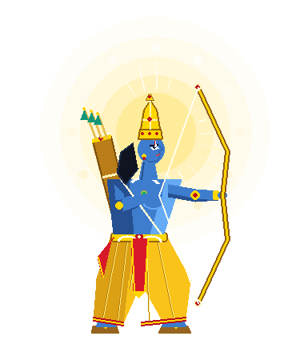
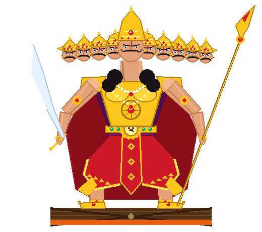
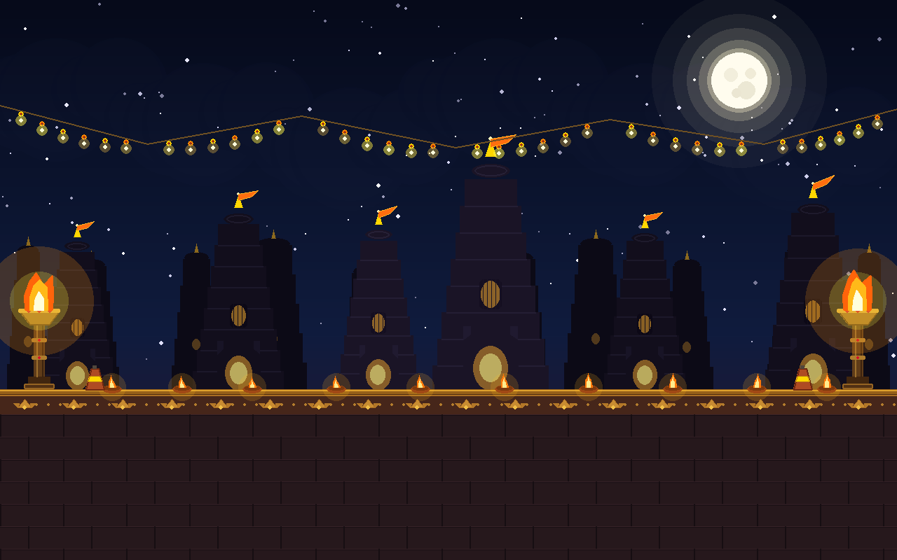
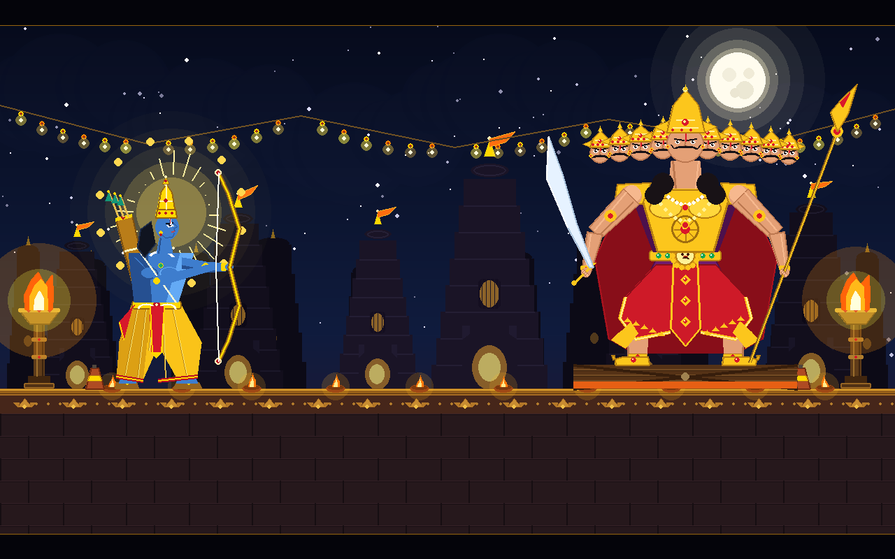
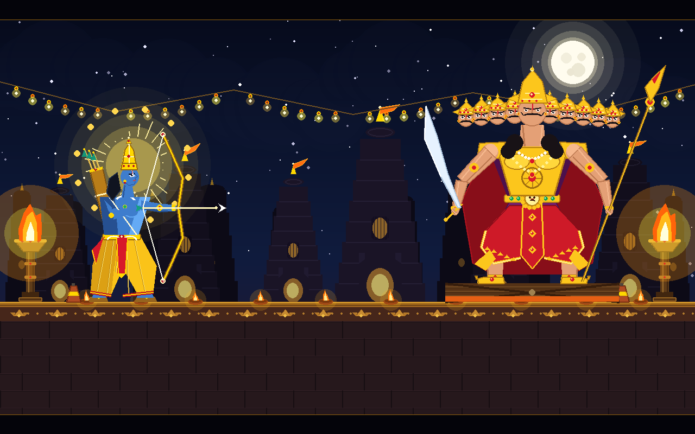
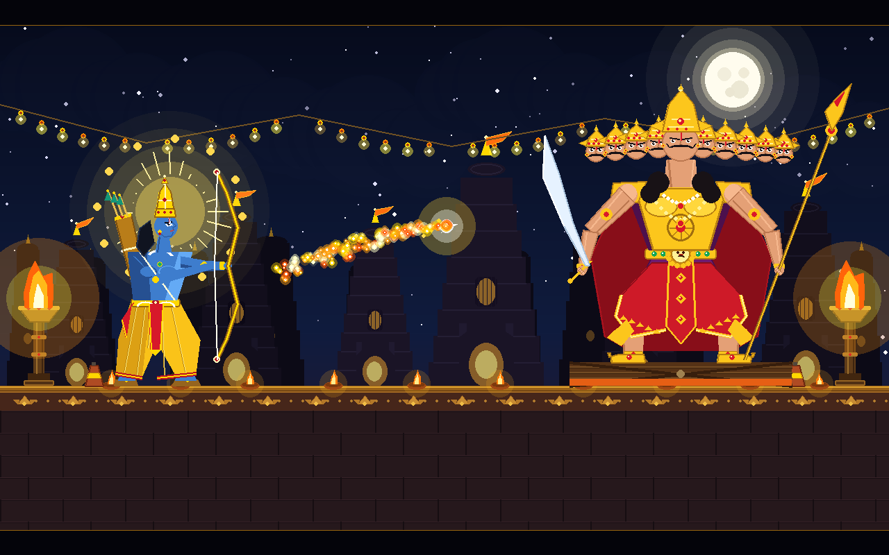
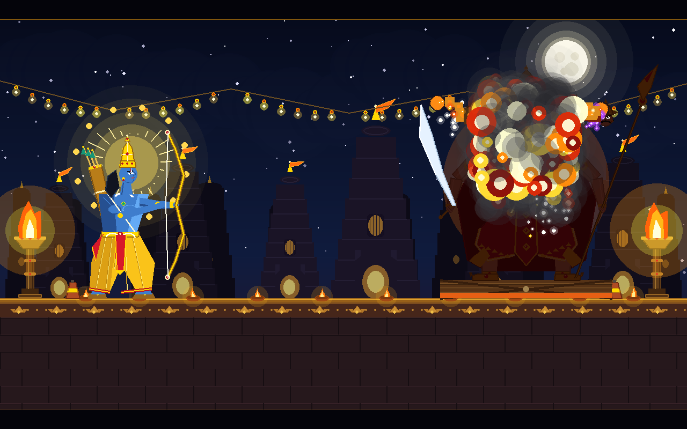
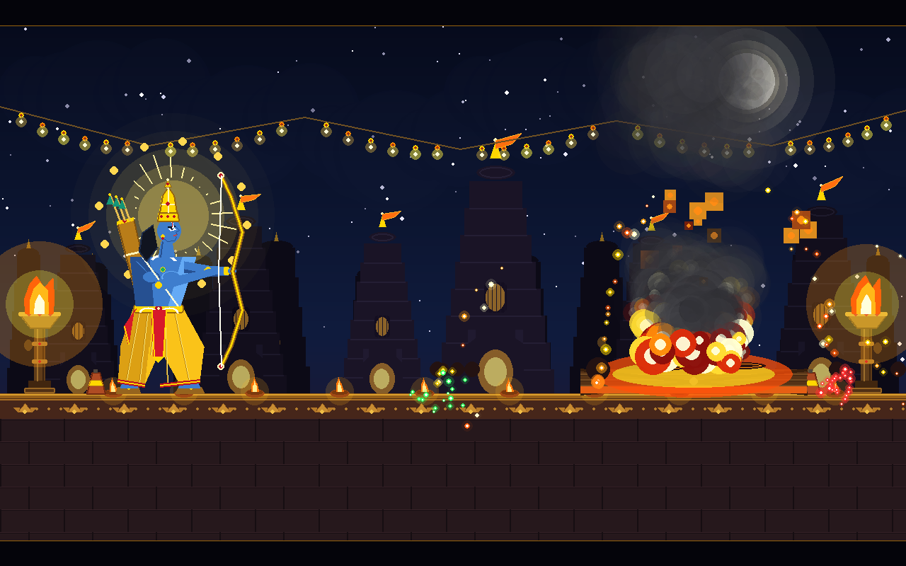
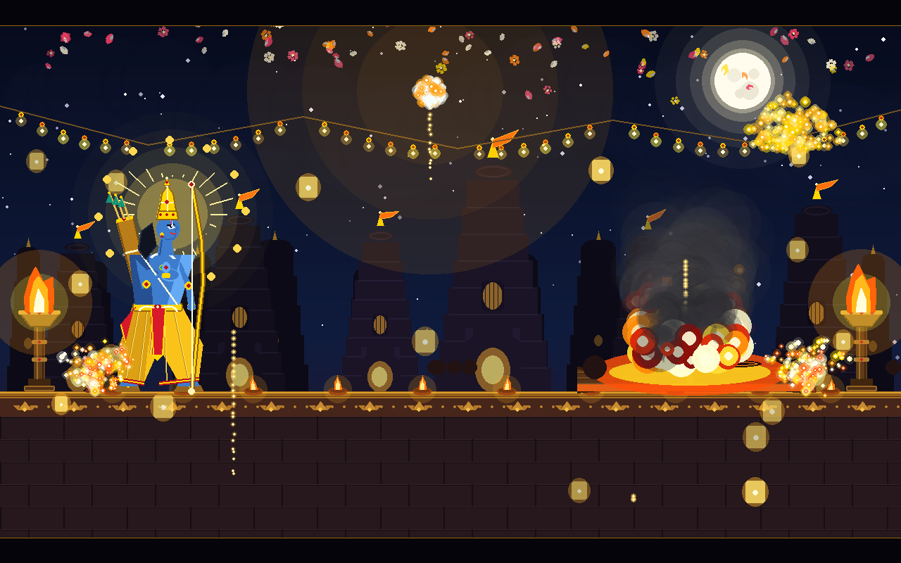

<div align="center">

# 🏹 VIJAYADASHAMI: CINEMATIC DUSSEHRA ANIMATION
### *The Divine Triumph of Dharma over Adharma*

[](https://www.python.org/)
[](https://pyga.me/)
[](https://numpy.org/)
[](https://github.com/)
[](LICENSE)

<br/>

> **॥ यतो धर्मस्ततो जयः ॥**  
> *"Where there is Dharma, there is Divine Victory."*

<br/>



<br/>

**A standalone, dual-engine Python cinematic experience crafted with hand-tuned 2D vector art, dynamic pyrotechnic physics, and real-time procedural DSP sound synthesis.**

[✨ Highlights](#-highlights) • [🎭 Character Showcase](#-character-art-showcase) • [🏛️ Scenic Environment](#%EF%B8%8F-scenic-temple-architecture) • [🎬 Storyboard Gallery](#-cinematic-storyboard-gallery) • [🎮 Controls](#-interactive-controls) • [🚀 Quick Start](#-quick-start) • [🔬 Architecture](#-technical-architecture--dsp-math)

---

</div>

## ✨ Highlights

- 🎨 **Pure 2D Procedural Vector Art**: No pre-rendered pixel bitmaps! Every character, sacred ornament, temple shikhara, flame, and garland is procedurally rendered using geometric math and alpha blending.
- 🔊 **Zero-Dependency Procedural Audio (NumPy DSP)**: Real-time mathematical synthesis of *all* sound effects (conch horn, bow tension, arrow whoosh, sub-bass Brahmastra explosion, effigy cracker strings, victory temple bells, and meditative Tambura drone).
- 🏹 **Authentic Epic Characters**: Dignified, anatomically sculpted Lord Rama (*Megha-shyam* raincloud complexion, golden *Pitambara* silk, *Kodanda* bow) facing the ten-headed demon king Ravana (*Dashanana* in a crescent crown arch with *Chandrahas* blade).
- 🔥 **Four-Stage Effigy Demolition Physics**: Solar plexus impact shockwave $\rightarrow$ core fire fissures $\rightarrow$ sequential head detonation with gravitational projectile tumbling $\rightarrow$ structural bamboo frame collapse into a roaring celebratory bonfire.
- 🎆 **Festive Victory Celebration**: Cascades of celestial flower petals (*Pushpa Vrishti*), glowing sky lanterns (*Kandils*), ground Anaar fountains, aerial fireworks, and 3D beveled golden victory typography.
- ⚡ **Dual-Engine Flexibility**: Runs at ultra-smooth 60 FPS on Pygame-CE with High-DPI scaling, with an integrated zero-dependency Turtle/Tkinter fallback engine.

---

## 🎭 Character Art Showcase

Clean, isolated 2D vector character assets rendered directly from the geometric engine with transparent alpha channels:

<div align="center">

| 🏹 Lord Rama (Bhagavan Shri Ram) | 👑 King Ravana (Dashanana of Lanka) |
| :---: | :---: |
|  |  |
| **Kshatriya Archer of Dharma** | **Ten-Headed Sovereign of Lanka** |
| • *Megha-shyam* celestial raincloud-blue skin tone<br/>• Golden *Pitambara* silk dhoti with saffron drape<br/>• Sacred *Yajnopavita* & *Navaratna* chest necklace<br/>• *Kirita-mukut* crown with iridescent peacock feather<br/>• Divine *Prabhamandala* ray halo and lotus mandala<br/>• Recurve *Kodanda* bow with dynamic string tension | • Ten distinct crowned heads in a royal crescent arch<br/>• Tiered golden mukuts with radiant ruby inlays<br/>• Embossed gold breastplate with 12-beam solar disc<br/>• Royal crimson & maroon robes with gold brocade<br/>• Dual articulated arms wielding divine *Chandrahas* sword<br/>• Firm warrior stance atop festive wooden stage |

</div>

---

## 🏛️ Scenic Temple Architecture

The cinematic backdrop represents a grand midnight sanctum rendered with rich Indian architectural motifs:



- **Sanctum Shikharas**: Dravidian and Nagara style temple spires featuring stepped *Urushringas*, ridged *Amalaka* stone discs, golden *Kalasha* pinnacles, and fluttering saffron *Dhwaja* banners.
- **Atmospheric Celestial Dome**: Multi-stop midnight indigo gradient, 160 twinkling stars with sinusoidal phase scintillation, and radiant full moon (*Chandra*) with crater details and multi-tier radial halos.
- **Sacred Illumination**: Traditional terracotta *Diyas* with pulsating flame glow, brass wind-swept *Mashaals* (torches), decorative marigold flower garlands (*Torans*), and Anaar flowerpot firecrackers.

---

## 🎬 Cinematic Storyboard Gallery

The animation progresses through a narrative arc from peaceful night to epic battle and triumphant festive celebration:

<div align="center">

| 01. Midnight Sanctum Intro | 02. Lord Rama Drawing Kodanda |
| :---: | :---: |
|  |  |
| *The tranquil temple courtyard under a glowing full moon.* | *Lord Rama takes aim with golden string deflection.* |

| 03. Brahmastra in Flight | 04. Ravana Effigy Ablaze |
| :---: | :---: |
|  |  |
| *Flaming Brahmastra streaks across sky with helical rings.* | *Fiery fissures erupt and effigy crackers pop violently.* |

| 05. Structural Frame Collapse | 06. Festive Fireworks Climax |
| :---: | :---: |
|  |  |
| *Effigy collapses into a bonfire while sky lanterns rise.* | *Multi-color aerial fireworks burst across the night sky.* |

</div>

---

## 🎮 Interactive Controls

| Key | Function | Description |
| :---: | :---: | :--- |
| <kbd>SPACE</kbd> | **Replay Animation** | Triggers a full cinematic reset from INTRO with fresh particle buffers and audio cues. |
| <kbd>F</kbd> | **Toggle Fullscreen** | Seamlessly switches between native High-DPI Fullscreen and 16:10 windowed mode. |
| <kbd>S</kbd> | **Cinematic Slow-Mo** | Engages **0.35x slow motion** to inspect arrow trajectories and tumbling head kinematics. |
| <kbd>P</kbd> | **Pause / Resume** | Halts simulation delta time and presents an ornamental golden pause plate. |
| <kbd>M</kbd> | **Mute / Unmute** | Toggles procedural synthesizer sound output and the ambient Tambura drone. |
| <kbd>ESC</kbd> | **Exit** | Cleanly frees audio mixer channels, deallocates surfaces, and exits. |

---

## 🚀 Quick Start

### Installation

```bash
# 1. Clone the repository
git clone https://github.com/addagatlasricharan/dussehra-animation.git
cd dussehra-animation

# 2. Install dependencies
pip install -r requirements.txt
```
*(Dependencies: `pygame-ce >= 2.5.0`, `numpy >= 1.24.0`, `pillow >= 10.0.0`)*

### Execution Options

```bash
# Run High-Fidelity 60 FPS Pygame Cinematic Engine (Default)
python "Happy Dussehra Animation.py"

# Run Lightweight Vector Turtle / Tkinter Engine (Fallback)
python "Happy Dussehra Animation.py" --turtle
```

---

## 🔬 Technical Architecture & DSP Math

### 1. Real-Time Procedural Audio Synthesizer (`ProceduralAudioEngine`)
All acoustic waveforms are generated algorithmically on-the-fly using vectorized NumPy arrays (44.1 kHz, 16-bit signed stereo):

- **Bowstring Tension**: Exponential linear chirp frequency sweep:
  $$f_{\text{draw}}(t) = 70 + \frac{170}{1.3} t \quad (t \in [0, 1.3\text{s}])$$
- **Brahmastra Launch**: Sharp transient twang accompanied by odd harmonics and high-frequency turbulence:
  $$W_{\text{launch}}(t) = \left[\sin(2\pi \cdot 280 t) + 0.6\sin(2\pi \cdot 560 t) + 0.3\sin(2\pi \cdot 840 t)\right] e^{-10t}$$
- **Brahmastra Sub-Bass Impact**: Multi-layered seismic boom combining descending frequency sweep ($130\text{Hz} \to 25\text{Hz}$), $42\text{Hz}$ sub-rumble, and noise burst:
  $$W_{\text{impact}}(t) = 0.85 \sin(2\pi f_{\text{sweep}}(t) t) e^{-2.8t} + 0.4 \sin(2\pi \cdot 42 t) e^{-1.5t} + \eta(t) e^{-6t}$$
- **Sacred Conch Horn (*Shankha*)**: Non-linear additive harmonic series ($f_0 \approx 220\text{Hz}$) with acoustic breath air:
  $$S(t) = \left( \sum_{k=1}^5 \frac{1}{k^{0.6}} \sin(k \phi(t)) + \eta_{\text{breath}}(t) \right) \cdot E_{\text{breath}}(t)$$
- **Temple Bell (*Ghanta*)**: Inharmonic acoustic chime partials with prolonged exponential damping:
  $$B(t) = \sum_{i=1}^5 A_i \sin(2\pi f_i t) e^{-d_i t} \cdot (1 - e^{-50t})$$
- **Sacred Tambura Bed**: Continuous classical Sa-Pa-Sa drone ($130.81\text{Hz}, 196.00\text{Hz}, 261.63\text{Hz}$) with smooth boundary crossfades.

### 2. Projectile Kinematics & Tangent Alignment
The Brahmastra traverses a parametric ballistic trajectory with analytical tangent angle alignment:
$$X(t) = X_0 (1 - \tau) + X_1 \tau$$
$$Y(t) = Y_0 (1 - \tau) + Y_1 \tau - h_{\text{arc}} \sin(\pi \tau)$$
$$\theta(t) = \operatorname{atan2}\left( \frac{dY}{dt}, \frac{dX}{dt} \right) = \operatorname{atan2}\left( (Y_1 - Y_0) - \pi h_{\text{arc}} \cos(\pi \tau), X_1 - X_0 \right)$$

### 3. Rigid-Body Effigy Head Detachment
Severed heads are dynamically simulated with independent velocity, spin, and gravitational acceleration:
$$v_y(t + \Delta t) = v_y(t) + g \cdot \Delta t \quad (g = 380\text{ px/s}^2)$$
$$x(t + \Delta t) = x(t) + v_x \cdot \Delta t, \quad y(t + \Delta t) = y(t) + v_y \cdot \Delta t$$
$$\theta_{\text{head}}(t + \Delta t) = \theta_{\text{head}}(t) + \omega_{\text{spin}} \cdot \Delta t$$
Upon hitting the ground rampart ($Y \ge 540$), a localized cracker burst is triggered.

---

## 📁 Repository Structure

```
dussehra-animation/
├── Happy Dussehra Animation.py  # Primary cinematic dual-engine application
├── requirements.txt             # Project Python dependencies
├── .gitignore                   # Git ignore specifications
├── LICENSE                      # Open-source MIT License
├── README.md                    # Modern aesthetic presentation & documentation
└── screenshots/                 # High-resolution gallery & character closeups
    ├── 01_night_sanctum_intro.png
    ├── 02_lord_rama_drawing_bow.png
    ├── 03_brahmastra_flight.png
    ├── 04_ravana_effigy_burning.png
    ├── 05_bonfire_and_sky_lanterns.png
    ├── 06_festive_fireworks_climax.png
    ├── 07_happy_dussehra_greeting.png
    ├── closeup_lord_rama.png              # Isolated transparent Lord Rama
    ├── closeup_king_ravana.png            # Isolated transparent King Ravana
    └── isolated_background.png            # Scenic temple backdrop without characters
```

---

## 📜 Cultural Significance & Lore

**Vijayadashami** (*Dussehra*) commemorates the epic victory of **Lord Rama** over **Ravana**, the king of Lanka, symbolizing the triumph of righteousness (*Dharma*) over evil (*Adharma*). On this auspicious day, colossal effigies of Ravana filled with festive firecrackers are ignited across India by an archer portraying Lord Rama, followed by celebratory fireworks, the exchange of Shami leaves (*Banni*), and prayers for courage, wisdom, and virtue.

---

## 📄 License & Attribution

This project is licensed under the [MIT License](LICENSE).  
Created with devotion, mathematical precision, and artistic craftsmanship by **Sri Charan Addagatla**.

<div align="center">

**✨ May the celestial light of Vijayadashami bring joy, prosperity, and victory to you and your family! Happy Dussehra! ✨**

</div>
